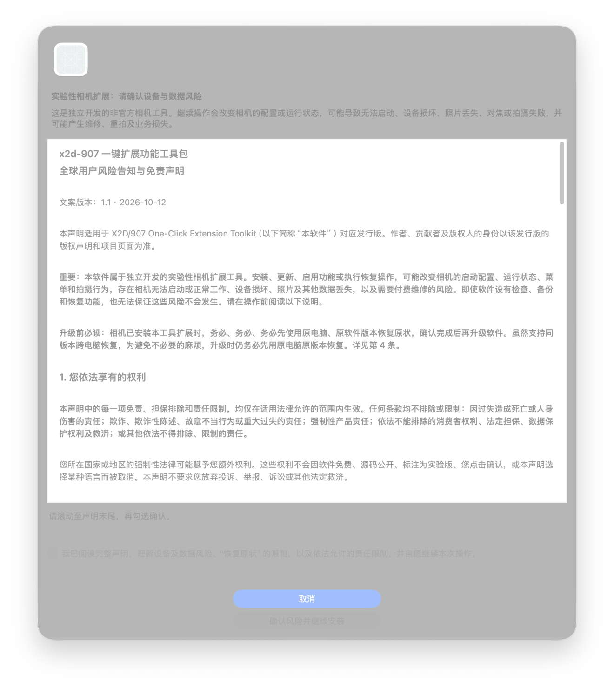
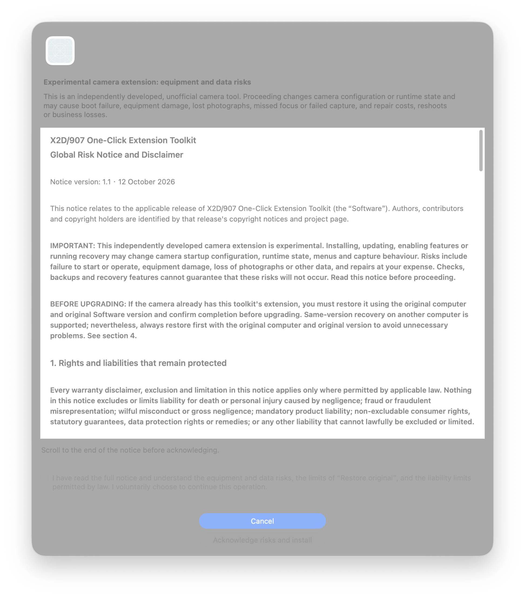

# X2D/907 One-Click Extension Toolkit

面向第一代 **X2D 100C / 907X & CFV 100C**、原厂固件 **4.2.0** 的实验性 Mac / Windows 扩展工具。本项目完全免费。

An independent, experimental camera-extension utility for the first-generation **X2D 100C / 907X & CFV 100C**, running stock firmware **4.2.0**. Free to download and use.

## 案例与恢复教程 / Cases and recovery guides

[**浏览案例库 / Browse all cases**](docs/cases/README.md) · [**X2D II Wi-Fi 原厂固件恢复教程 / X2D II firmware recovery**](docs/cases/2026-10-14-x2d-ii-wifi-firmware-recovery/README.md)

案例库按日期、机型与问题分别归档，包含原理、适用条件、操作步骤、脚本和验证结果，后续案例会持续加入。首个案例提供 Windows + 已授权 iPhone 的完整恢复流程，以及可打包下载的独立源码。**X2D II 案例工具独立于一代桌面安装器；已记录一次用户操作成功，不代表支持所有故障或固件版本。**

Each case has its own explanation, requirements, instructions, tools and evidence. The first guide provides the Windows + already-authorized iPhone recovery procedure and a portable source-package recipe. **The X2D II case tools are separate from the first-generation desktop installer; one reported recovery does not establish support for every fault or firmware version.**

## 升级前必读 / Read before upgrading

**相机已安装本工具扩展时，升级软件前务必、务必、务必先使用原电脑、原软件版本执行“一键恢复原状”，确认恢复完成后，再升级电脑端软件并重新安装相机扩展。** 恢复完成前，不要卸载、覆盖或删除原软件及备份。同版本跨电脑恢复的支持，不代表可以任意跨版本恢复。

**If your camera already has this toolkit's extension, restore it using the original computer and original app version, and confirm completion before upgrading the desktop app and reinstalling the extension.** Keep the original app and backups until recovery is complete. Same-version recovery on another computer does not imply arbitrary cross-version recovery.

[完整升级顺序 / Upgrade procedure](docs/UPGRADING.md) · [中文风险告知与免责声明](docs/DISCLAIMER.zh-CN.md) · [English risk notice and disclaimer](DISCLAIMER.md)

## 下载 0.5.6 · 恢复修复版 1 / Download 0.5.6 · Restore fix 1

**当前公开版本：0.5.6 · 恢复修复版 1（预发布）。** 针对已识别旧版安装的恢复失败，先等待拍摄结束、安全退出连续对焦并确认空闲，再执行严格撤回。旧版恢复失败时，可用本版检查连接后直接恢复，无需先安装新版功能；仅支持已收录清单及完好、可核验的备份。

**Current public release: 0.5.6 · Restore fix 1 (prerelease).** Wait for capture to finish, safely leave continuous AF and verify idle before guarded withdrawal. If an older toolkit cannot restore, this revision can check the connection and restore directly without installing new features; only registered manifests and intact, verifiable backups are supported.

**已知未修复：眼部布局校验失败可能连带阻止追踪自动对焦开启。本次仅修恢复流程，相机载荷未改动；请勿反复重装同一版本尝试解决该问题。相机恢复实测及 Windows 原生验证仍待完成。**

**Known unresolved issue: Eye layout validation failure can also block Tracking Autofocus activation. This revision fixes recovery preparation only; camera payloads are unchanged. Reinstalling the same build does not fix that issue. Physical-camera recovery and native Windows validation remain pending.**

| 平台 / Platform | 安装包 / Download |
| --- | --- |
| macOS 13+ · Apple silicon / Intel | [**Mac 通用版 / macOS Universal · Restore fix 1**](https://github.com/Gothenburg-R-D-Team/x2d-907-one-click-extension-toolkit/releases/download/v0.5.6/x2d-907-extension-toolkit-macOS-Universal-0.5.6-restore-fix-1.zip) |
| Windows 10 / 11 · x64 | [**Windows x64 · Restore fix 1**](https://github.com/Gothenburg-R-D-Team/x2d-907-one-click-extension-toolkit/releases/download/v0.5.6/x2d-907-extension-toolkit-Windows-x64-0.5.6-restore-fix-1.zip) |

下载后请**完整解压**再启动。Extract the **entire ZIP** before opening the app.

[0.5.6 发行说明 / Release notes](https://github.com/Gothenburg-R-D-Team/x2d-907-one-click-extension-toolkit/releases/tag/v0.5.6) · [SHA-256 校验 / Checksums](https://github.com/Gothenburg-R-D-Team/x2d-907-one-click-extension-toolkit/releases/download/v0.5.6/SHA256SUMS) · [0.5.6 验证记录 / Validation record](https://github.com/Gothenburg-R-D-Team/x2d-907-one-click-extension-toolkit/releases/download/v0.5.6/0.5.6.json)

**稳定版仍为 [0.4.17](https://github.com/Gothenburg-R-D-Team/x2d-907-one-click-extension-toolkit/releases/tag/v0.4.17)**，保留原有更新入口。0.5.6 从本页手动下载；启动时检查更新不会自动下载安装 0.5.6。

**[0.4.17 remains the stable release](https://github.com/Gothenburg-R-D-Team/x2d-907-one-click-extension-toolkit/releases/tag/v0.4.17)** with its existing update channel. Download 0.5.6 manually from this page; startup update checks do not automatically download or install it.

[中文使用说明](#中文使用说明) · [English setup](#english-setup) · [更新日志 / Changelog](CHANGELOG.md) · [交流与参与 / Contributing](#交流与参与--contributing)

## 0.5.6 更新 / What changed

- **像素位移仅限 X2D 100C。** 检测为 907X／CFV 100C，或尚未完成型号核验时，选项自动取消勾选并置灰；安装前再次核验实际型号。
- **使用像素位移前手动选择纯 RAW。** JPEG、RAW+JPEG 均不满足此要求；非 RAW 时参数及设置入口变灰，保留提示文字。软件不再自动修改照片格式。
- **完整免责声明接入 Mac／Windows 三语言界面。** 采用放大的滚动弹窗，必须滚动至末尾，再手动勾选确认才能安装；取消不启动相机操作。恢复使用独立提示。

- **Pixel Shift is available only on X2D 100C.** The option is cleared and disabled on 907X / CFV 100C and until model verification completes. Installation checks the actual model again.
- **Select RAW manually before Pixel Shift.** JPEG and RAW+JPEG do not satisfy the RAW-only requirement. Parameters and settings are disabled for non-RAW formats while the guidance remains visible. The app no longer changes the photo format automatically.
- **The full risk notice is integrated into both desktop apps in three languages.** The larger dialog requires scrolling to the end and then explicitly checking the acknowledgement before installation. Cancel starts no camera operation; Restore uses a separate prompt.

## 功能 / Features

| 功能 / Feature | 说明 / Behavior |
| --- | --- |
| AF-C 连续自动对焦 / Continuous Autofocus | 在相机中提供可选的连续对焦模式。Adds continuous autofocus as a selectable camera mode. |
| 追踪自动对焦 / Tracking Autofocus | 提供 AF-T 人脸追踪对焦模式。Adds an AF-T face-tracking focus mode. |
| 人眼识别 / Eye Recognition | 提供独立的人眼识别开关；选择 AF-T 时暂停该识别状态，返回 AF-S／AF-C 后按原开关选择恢复。Independent Eye switch; selected AF-T pauses Eye, while AF-S / AF-C resumes it according to the saved choice. |
| 对焦加速 / Focus Speed Boost | 低／中／高三档可选，关闭后恢复原厂速度。Low / Medium / High levels; disabling restores stock speed. |
| 后屏自动亮度 / Auto Rear Brightness | 根据环境光调整后屏亮度，可设置最高亮度。Adjusts rear-display brightness to ambient light, with a configurable maximum. |
| 像素位移 / Pixel Shift | **仅 X2D 100C**，通过驱动模式使用，支持 4／6／16 张 RAW 序列、初始延迟、帧间等待与倒计时提示；电脑合成需另行进行。**X2D 100C only**: Drive Mode entry for 4 / 6 / 16 RAW sequences, initial delay, frame interval and countdown; desktop merging is separate. |

像素位移默认不勾选。未选择安装的功能不会出现在相机对应菜单中。相机菜单文案随安装时 App 语言变化：英文为 **Tweaks**，简体／繁体中文为 **耍起功能**。

Pixel Shift is unchecked by default. Unselected features are omitted from the corresponding camera menus. Camera text follows the app language at installation: **Tweaks** in English, **耍起功能** in Simplified or Traditional Chinese.

对焦加速可安装，但不建议老镜头用户在相机内开启该功能。档位倍率描述镜头电机控制参数，不代表实测整体对焦速度提升或镜头安全保证。

Focus Speed Boost can be installed, but users of older lenses are advised against enabling it in the camera. Its multipliers describe motor-control parameters, not measured overall autofocus gains or a lens-safety guarantee.

907 用户在机型核验后仍可选择原有彩蛋入口。The existing optional 907 Easter egg remains available after model verification.

## 中文使用说明

1. **升级用户先恢复。** 按[升级流程](docs/UPGRADING.md)使用原电脑、原安装版本恢复并确认完成，再替换电脑端软件。首次安装无需先恢复本工具的旧安装。
2. 完整解压对应平台安装包，开机并连接 USB 数据线；相机出现 **“跳过”** 时点击“跳过”。
3. 点击 **“已连接”**，等待型号、固件和文件检查完成。Windows 若出现管理员授权提示，请按提示处理。
4. 选择要安装的功能。907X／CFV 100C 不可选择像素位移；X2D 的像素位移默认不勾选。
5. 点击 **“安装所选功能”**，将完整风险声明滚动至末尾，阅读后手动勾选并确认。安装、重启和校验期间保持相机供电和数据线连接，直到 App 明确提示完成。
6. 在相机主菜单末尾打开 **“耍起功能”**，开启总开关及所需功能。像素位移从**驱动模式**进入，使用前手动选择**纯 RAW**；其序列需另在电脑合成。
7. 撤回时连接相机，点击 **“已连接 → 一键恢复原状”**，按独立恢复提示操作并等待完成。

App 在设置中提供简体中文、繁體中文、English；更换相机菜单语言需要按升级／重新安装流程处理。

恢复只撤回本工具管理且可核验的改动，不能覆盖任意第三方补丁。若检查未通过或恢复未完成，保留原软件、安装记录和备份，通过 [Issues](https://github.com/Gothenburg-R-D-Team/x2d-907-one-click-extension-toolkit/issues) 反馈；公开日志前请移除个人信息。

## English setup

1. **Restore before upgrading.** Follow the [upgrade procedure](docs/UPGRADING.md) with the original computer and original installer, and confirm completion before replacing the desktop app. A first installation does not require restoring a previous toolkit installation.
2. Extract the complete package for your platform. Turn on the camera, connect a USB data cable and tap **Skip** if shown on the camera.
3. Click **Connected** and wait for model, firmware and file checks. Handle administrator prompts on Windows if requested.
4. Select the features to install. Pixel Shift is disabled on 907X / CFV 100C and unchecked by default on X2D.
5. Click **Install selected features**. Scroll to the end of the full risk notice, read it, then explicitly check the acknowledgement and confirm. Keep stable camera power and USB connection through installation, restart and verification until the app reports completion.
6. Open **Tweaks** at the end of the camera's main menu, enable the master switch and choose the required features. Pixel Shift is accessed through **Drive Mode** and requires manually selected **RAW**, without JPEG. Merge the resulting sequence separately on a computer.
7. To withdraw the extension, reconnect and use **Connected → Restore original**, following the separate recovery prompt until completion.

Settings offers Simplified Chinese, Traditional Chinese and English. Changing camera-menu text requires the restoration/reinstallation procedure.

Restore withdraws changes managed and verified by this tool; it cannot overwrite arbitrary third-party patches. If checks or recovery fail, keep the original app, installation records and backups, and report through [Issues](https://github.com/Gothenburg-R-D-Team/x2d-907-one-click-extension-toolkit/issues). Remove personal information before sharing logs publicly.

## 声明弹窗 / Risk notice dialog

0.5.6 的 Mac 原生弹窗，来自离线界面检查；截图展示尚未滚动至末尾时的禁用状态。软件界面检查不代表相机安装验证。Windows 同样要求滚动到底并手动勾选，原生显示验证仍待完成。

Native Mac 0.5.6 dialogs captured during offline UI checks, before the end-of-document gate unlocks. These are desktop UI checks, not camera-installation evidence. Windows uses the same scroll-and-acknowledge requirement; native Windows display validation remains pending.

[中文完整声明](docs/DISCLAIMER.zh-CN.md) · [Full English notice](DISCLAIMER.md)

## 验证范围 / Validation

恢复修复版 1 的 382 项离线回归中 **380 项通过、两项原厂区域仿真不可用**，未将跳过项计为通过；另有 23 项界面／本地化回归、Mac 原生界面检查和 Windows 解压包 130 项回归通过。补充验证 49 项恢复回归、1,369 个当前／旧版清单组合，以及 108 个桌面／文件恢复替身用例。Windows 原生运行、真实驱动安装、相机安装／恢复／拍摄和光学效果仍待相应实机验证。具体记录与限制见 [0.5.6.json](https://github.com/Gothenburg-R-D-Team/x2d-907-one-click-extension-toolkit/releases/download/v0.5.6/0.5.6.json)。

Restore fix 1 passes **380 of 382 offline regressions; two unavailable stock-region simulations are not counted as passes**, plus 23 UI/localization regressions, native Mac UI checks and 130 extracted Windows regressions. Additional checks cover 49 focused recovery regressions, 1,369 current/older manifest combinations and 108 host/file-restore fixture cases. Native Windows execution, actual driver installation, camera installation / restoration / capture and optical results still require the respective device validation. See [0.5.6.json](https://github.com/Gothenburg-R-D-Team/x2d-907-one-click-extension-toolkit/releases/download/v0.5.6/0.5.6.json) for the exact evidence and limits.

本项目为独立研究工具，非哈苏官方软件。仅适配明确列出的机型与固件。Mac App 使用临时签名、未经公证；Windows 启动器未经代码签名。

This is an independent project, not an official Hasselblad product. Only the stated camera models and firmware are supported. The Mac app uses an ad-hoc signature and is not notarized; the Windows launcher is unsigned.

Git 中保存源码、测试、文档和软件截图；原厂固件、编译后的厂商组件、运行库与安装压缩包不提交到 Git。安装包以对应 [Release 附件](https://github.com/Gothenburg-R-D-Team/x2d-907-one-click-extension-toolkit/releases/tag/v0.5.6)为准；公开仓库当前源码与 0.5.6 安装包的构建源码并不同步。

Git contains source, tests, documentation and software screenshots; vendor firmware, compiled vendor components, runtimes and installer archives are excluded. Use the corresponding [Release assets](https://github.com/Gothenburg-R-D-Team/x2d-907-one-click-extension-toolkit/releases/tag/v0.5.6) for installers; the public repository's current source does not yet match the 0.5.6 package build source.

## 交流与参与 / Contributing

欢迎分享使用反馈、研究发现，并通过 [Issues](https://github.com/Gothenburg-R-D-Team/x2d-907-one-click-extension-toolkit/issues) 讨论问题，或提交 [Pull Requests](https://github.com/Gothenburg-R-D-Team/x2d-907-one-click-extension-toolkit/pulls) 改进代码、文档与测试。

Feedback, research findings and developer contributions are welcome. Open an [Issue](https://github.com/Gothenburg-R-D-Team/x2d-907-one-click-extension-toolkit/issues) or submit a [Pull Request](https://github.com/Gothenburg-R-D-Team/x2d-907-one-click-extension-toolkit/pulls) to improve code, documentation and tests.

贡献者保留各自贡献的版权，不要求版权转让。贡献授权、既有贡献许可和许可变更规则见 [CONTRIBUTING.md](CONTRIBUTING.md)。

Contributors retain copyright; no assignment is required. Contribution licensing, existing-contribution and license-change rules are in [CONTRIBUTING.md](CONTRIBUTING.md).

## 许可 / License

本仓库采用下述 1.1 版许可；既有发行版继续适用其各自携带的许可。更新根目录许可不追溯改变历史权限或自动更改既有贡献的授权。

This repository uses the version 1.1 license below. Existing releases retain their accompanying licenses. Updating the root license does not retroactively change historical permissions or automatically relicense existing contributions.

### 中文说明

对于明确采用 [X2D/907 免费分发许可证 1.1](LICENSE) 的版本，允许免费使用、
研究、修改、构建和分享。禁止出售软件或改版、收费下载或访问、订阅、付费解锁、
付费专享或提前访问，以及收费安装、设置、配置或部署；不保留书面批准收费的例外。

**允许商业摄影、收费拍摄、影棚工作及出售摄影作品。** 照片及其他摄影成果不会
仅因使用本软件而受本许可证约束，也无需向项目支付费用或分成。

公开发布二进制安装包时，须同时免费公开对应版本的完整项目源码、构建脚本、
依赖信息和构建说明。通过链接提供源码的，应在最后一次分发该版本后至少保留三年。
内部开发和测试可以暂不公开；向测试者分发二进制时，仍须向其提供对应源码。
第三方组件和厂商固件保留各自许可，不因此承诺公开或再分发无权提供的材料。

官方承诺整个项目及未来功能持续免费，不提供收费授权。完全自愿且不换取软件权益
的捐赠可以接受。详见 [项目政策](PROJECT_POLICY.md)。

本项目属于带有收费分发限制的 **source-available（源码可获取）软件**，
并非采用 OSI 认可许可证的开源软件。历史 MIT 材料保留原有许可权限。
英文 [LICENSE](LICENSE) 为正式许可正文；本摘要仅供说明。

### English

Versions expressly released under the [X2D/907 No-Charge Distribution
License 1.1](LICENSE) may be used, studied, modified, built and shared without
charge. Selling the Software or modified versions, paid downloads or access,
subscriptions, paid unlocks, paid exclusive or early access, and paid
installation, setup, configuration or deployment are prohibited. There is no
written-permission exception for those charges under this license.

**Professional photography, paid shoots, studio work and selling photographs
are permitted.** Photographs and other photographic deliverables do not
become subject to this license merely through use of the Software, and no
project fee or revenue share is required.

Public binary releases must be accompanied by freely available corresponding
project source, build scripts, dependency information and build instructions.
Source provided through a link must remain available for at least three years
after the distributor's last distribution of that version. Private development
and testing need not be public, but recipients of private binaries must still
receive corresponding source. Third-party components and vendor firmware
retain their own licenses; this does not promise disclosure or redistribution
of materials the project has no right to provide.

The official project commits to keeping all its software and future features
free and to offering no paid software licenses. Fully voluntary donations that
purchase no software privileges are permitted. See [Project Policy](PROJECT_POLICY.md).

This is **source-available software with restrictions on software charges**,
not software under an OSI-approved open-source license. Historical MIT
materials retain their original permissions. The English [LICENSE](LICENSE)
is authoritative; this summary is informational.

第三方组件的许可与来源见 [THIRD_PARTY_NOTICES.md](THIRD_PARTY_NOTICES.md)。Third-party licenses and provenance are listed in [THIRD_PARTY_NOTICES.md](THIRD_PARTY_NOTICES.md).
