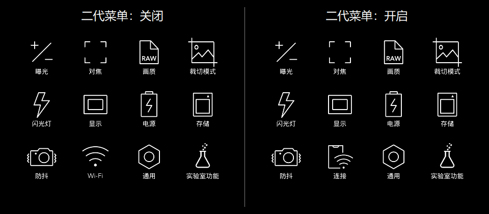

# X2D 二代界面与“连接”图标开发交接

日期：2026-10-15。交接对象：Radium。来源：本地 0.6.2「连接菜单1」快照。目标仅为 **X2D 100C 原厂 4.2.0**，不是 X2D II 固件移植或已经验收的新版安装器。

本目录把整条界面加载链及连接图标依赖集中成可审查源码快照，不替换上游默认产品入口，不会因检出仓库自动安装相机。原厂 GUI、camera-service 和原厂共享库磁盘文件不允许覆盖或补丁。新增私有库、启动配置变化、进程内存 Hook 是三类不同修改。

## 文件入口

- [界面、宿主与原生参考源码](../../../src/x2d2_ui_handoff_062/)；[文件与目标路径索引](../../../src/x2d2_ui_handoff_062/asset-index.json)；[逐文件来源与导出哈希](../../../src/x2d2_ui_handoff_062/source-provenance.json)。
- `camera/`：全部当前 QML / JS / SVG，含简体、英文、繁体；Bootstrap、菜单模型／路由／容器、AF-C 菜单、主体选择、取景反馈、区域控制和附属页面。
- `host/`：现有桌面入口、工厂 USB / ADB 适配、特性筛选、安装与恢复事务、准确历史清单校验所需宿主源码；这是审查快照，不是新的部署授权。
- `loader-reference/`：上游 `native_menu_preload.c`、原构建脚本、资源准备及亮度依赖。它是原加载器源码参考，不声称与本交接的已编译 `.so` 一次构建逐字节一致。
- `native-reference/`、`service-reference/`：关联区域／声音模块和服务脚本，供依赖与退出路径审查；连接图标本身没有新增 native hook。
- [本轮静态检查](../../../tests/check_ui_connection_handoff.py)。测试不会导入或执行宿主后端。

## 加载链

现有宿主检查型号、固件和核心哈希，筛选文件及语言。准确备份并核对 `camera-gui.rc` 后，在该启动配置中给原厂 GUI 设置 `X2D_NATIVE_MENU` / `LD_PRELOAD`，加载新增的 `libx2d_native_menu.so`。原程序磁盘字节保持不变，但预加载器构造函数会核验固定版本缓存并改动**当前 GUI 进程内**的 QML 缓存指针及相关开关；这确实改变原进程行为，不能写成“对原程序无影响”。

`X2dNativeMenuBootstrap.qml` 查找原厂 MainScreen / ControlDrawer / GridView，保存原模型、delegate 与信号路由，再挂接私有模型、路由和控制器。退出时恢复原模型、delegate、信号和动态绑定。附属功能仍需要各自后端；菜单出现不代表 AF 引擎、区域统计或追踪已经验证。

## “连接”新图标

这里的 Logo 是菜单中的**手机＋Wi-Fi 图标**，不是启动 H 标、品牌 Logo 或肩屏图像。

`X2dConnectionMenu.qml` 与英文／繁体版本只修饰原 `wifiMenu` 按钮的 `text`、`source`。图标为 `X2dConnectionMenuIcon.svg`，来源 X2D II 1.3.16.2，SHA-256：`a10338a059e866a5cfdb11f2a70cf9f6ed1f8d5c945ed7dd3ad77b5e5fc8514c`。

Bootstrap 将 active 绑定到已有二代菜单开关。关闭、布局不识别、未就绪或销毁时，用 `Binding.RestoreBindingOrValue` 恢复实时原绑定。没有新增 Camera API、网络请求、Wi-Fi 配置或点击路由；无需新增持久偏好。简体显示“连接”，英文 `Connections`，繁体“連線”。



该图片来自桌面 Qt 替身环境，不是相机截屏，不作为实机外观、冷启动或恢复证据。

## 原厂文件、新增文件与运行时影响

| 类别 | 交接边界 |
|---|---|
| 原厂 executable / shared library | 不覆盖、不修改磁盘字节；不附原厂 ELF、固件镜像或备份 |
| 私有新增模块 | 原加载器等由现有包提供；公开源码及文件哈希，生成二进制不入 Git |
| 启动配置 | 历史安装器会改 `camera-gui.rc`；区域后端另涉 `camera-service.rc`；必须独立准确备份、归属核验、恢复 |
| 运行时 | GUI 缓存指针／开关 Hook；选择区域等附属功能还会改变原 AF API 输入；连接图标只改显示绑定 |
| 本次操作 | 只离线整理、校验、提交源码；没有连接、安装、恢复、重启或拍摄相机 |

## 原样保留与公开范围

本地完整交接 ZIP 保留当前 `native-package`、全部历史 manifests 和 `previous-payloads`，没有删除恢复载荷或转换其字节。它与公开 PR 源码不同：生成的库、厂商衍生编译单元、运行库、设备日志、个人路径及实际运行 token 不提交 Git。公开源码中的区域 token 改为 `HANDOFF_TOKEN_NOT_CONFIGURED`，不能直接当成部署载荷；来源哈希与导出哈希单独列出。

重建原加载器仍须使用有权持有的准确 X2D 4.2.0 GUI / libc / libdl、已审核的 `inspect_menu_resources.py` / `firmware_image.py` 支持及对应原厂 UI 输入。当前源码快照没有虚构这些输入，也没有把一个参考构建冒充完整可复现的发布构建。沿用上游 `src/build_native_preload.py` 的输入资格检查，再叠加本目录当前文本 UI；集成者必须重封准确 manifest 并保留历史版本，不能直接重用旧哈希。

图标和与固件有关的 UI 仍保留厂商权利归属，不因仓库 MIT 许可证变成重新许可的厂商资源；相关说明见 [来源与许可](PROVENANCE.md)。

## 验证与恢复资格

历史桌面测试执行了连接控制器三语言、开关与销毁恢复、原按钮点击 `wifiMenu`、原模型不改写、行重排、未就绪与不识别布局回退。历史包级比较覆盖 285 种配置，连接改动没有改变已有 native 库和启动配置。这是历史离线结果，本轮不将其改写成重新实机验收。

当前区域功能是 AF-S 实验矩形／一次邻域重试，未实现二代逐点矩阵自动选择。此前区域与人脸反馈离线核验发现迟到 Success 可能错误变绿，不能仅凭框颜色判断照片合焦。

恢复源码和本地历史载荷保留，但**不是所有异常恢复场景已通过**。已知缺口：当扩展库不能加载、核心服务重启循环或原生撤回失败时，不能要求失败扩展先报告健康才能恢复。正常恢复、安装中断、恢复中断及失败原生撤回必须在集成发布前重新资格验证。本轮仅核对记录保留和失败前不删除的静态边界，没有把替身检查称为冷启动／硬件验证。

用户提供的 R4 H 标事故只作为经验：核对 ARM64 flags；审查 constructor、`_exit` / exit、alarm 和 signal；功能 OFF 也可能运行构造函数；区分私有 helper 退出与原厂宿主退出。不得把 CFV 应急步骤直接用于 X2D。本交接不包含或执行事故恢复命令，不承诺零硬件风险。

## 离线检查

在仓库根运行：

```sh
python tests/check_ui_connection_handoff.py
```

它检查快照文件哈希、目标及语言依赖、图标、Bootstrap 绑定、显示控制器无相机调用、无原厂 ELF／运行库、源码语法与隐私、恢复源码保留；不访问 USB，不执行安装器。硬件、ARM64 构建字节一致性、故障恢复与上游默认产品整合仍待完成。

## 本轮复跑记录

2026-10-15 静态检查通过 770 项断言。重新执行当前交接目录中的实际连接控制器：简／英／繁三个版本、菜单关闭与销毁、原路由点击、原模型保持、行重排、未识别布局和未就绪回退均通过；QML 错误为零。使用桌面 Qt、原厂按钮源码及替身常量／图像适配，没有访问相机。

可选 Qt 复跑需 PySide6 和自行提取的固件分析目录；设置 `X2D_FIRMWARE_ANALYSIS`，必要时设置 `X2D_QT_PYTHONPATH`，然后运行 `python tests/check_ui_connection_runtime.py`。原厂 QML 输入不在仓库中。当前结果不等于 ARM64 库、冷启动、故障撤回或硬件验证。
